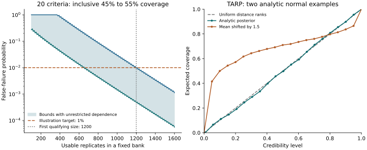

# Coverage planning and TARP

`CoverageRule` describes a prespecified range for one empirical posterior-coverage
proportion. The core planner uses SciPy's binomial probabilities to assess a fixed
bank, with all supplied coverage criteria required to pass. The optional TARP
adapter reports a joint distance-rank coverage curve using the public reference
package. These are separate diagnostics; neither certifies an inference method.



The left panel uses 20 hypothetical 50% coverage criteria, each requiring empirical
coverage between 45% and 55% inclusive. The shaded region bounds the family's
false-failure probability without assuming independent criteria. The right panel
uses an analytic bivariate Normal posterior and deliberately shifted draws, with
explicit data-dependent reference points. The diagonal is a continuous-rank
reference, not a confidence band.
The plot samples every tenth bank size; the planner checks every integer.

--8<-- "docs/assets/coverage/summary.txt"

These numbers belong to the declared examples, not scientific package defaults.
The [executable source](https://github.com/ACCIDDA/op_infer/blob/main/examples/coverage_diagnostics.py)
retains [rounded plotted values](assets/coverage/data.json), source/export
[identities and rendering versions](assets/coverage/manifest.json), and a
[PDF export](assets/coverage/figure.pdf). Numeric plot inputs are rounded to 12
decimal places for checks across dependency versions; the diagnostic APIs return
their original precision. This is an analytic illustration, not a powered
qualification of a consumer's full gate policy.

## Plan the complete coverage family

```python
from op_infer.calibrate import (
    CoverageRule,
    coverage_operating_characteristics,
    plan_coverage_replicates,
)

rules = (
    CoverageRule(name="theta_50", nominal=0.5, lower=0.45, upper=0.55),
    CoverageRule(name="theta_90", nominal=0.9, lower=0.85, upper=0.95),
)
plan = plan_coverage_replicates(rules, max_false_fail=0.01, max_replicates=5000)
report = coverage_operating_characteristics(rules, n_replicates=1000)
```

Names identify the estimand and nominal-level criterion. Ranges may be asymmetric
and must contain the nominal probability. Include the entire family: planning one
rule and applying it across many estimands changes the gate's false-failure rate.
For a bank of size `n`, the planner finds the integer success counts whose actual
floating-point proportions satisfy each inclusive bound. It evaluates the two
binomial tails through `scipy.stats.binom.cdf/sf`, and bounds the probability of
any violation between the largest marginal rejection probability and their sum,
capped at one. The upper bound is conservative; it is not an independence model
or an estimate of the actual joint rejection probability.

The planner checks every integer size up to the explicit search budget. Lattice
effects make rejection probabilities nonmonotone, so binary search or rounding a
qualifying count upward can fail. The returned plan applies to its exact count.
An insufficient budget returns `available=False`, no selected count and a reason.
The supplied rules, target, budget, accepted counts and SciPy version remain in the
report. Save them before running the bank; use the existing ledger/provenance and
[gate records](gates.md) to retain the broader study context.

Under calibration, each indicator must have success probability `nominal`, with
independent replicates within each rule. Randomized PITs handle atoms in the
central-interval calculation; finite posterior sampling can change the effective
coverage probability. `n_replicates` counts usable replicates, not attempted fits.
Failed or inadequate fits require their own counted failure policy. Conditioning
on successful fits can change calibration if failures depend on the simulated
truth or data. A plan does not establish those assumptions, qualify MCMC, or cover
other gate criteria or repeated interim looks. `adequacy_status` remains
`not_assessed`.

To assess a specified alternative, supply a complete `probabilities` mapping to
`coverage_operating_characteristics`. Its family bounds then describe rejection
power under those probabilities. Biased, overconfident or otherwise misspecified
posteriors must still be checked under the project's full reading rule; there is
no universal replicate count that qualifies every gate.

## Report a TARP curve

Install `op_infer[tarp]`. The adapter calls `tarp.get_tarp_coverage` with Euclidean
distance, `norm=False`, `bootstrap=False` and an explicit credibility-bin count.
TARP 0.1.1 chooses histogram edges from the observed distance-rank range. The
adapter preserves the returned credibility grid, including endpoints inside
`[0, 1]`; it does not replace those edges with a full-range grid. A reference
curve with out-of-range probabilities or edges is unavailable.
`max_abs_deviation` compares entries on the returned credibility grid.
There is no inference-library or plotting dependency in this extra. It declares
the reference package's otherwise missing `deprecation` and `tqdm` imports.

```python
from op_infer.adapters.tarp import tarp_coverage

# Supply the original complete bank and independently constructed metadata.
result = tarp_coverage(
    posterior_samples,  # (draw, replicate, quantity)
    truths,  # (replicate, quantity)
    references=reference_points,  # same shape as truths
    replicate_ids=planned_ids,
    quantities=("theta_1", "theta_2"),
    definition=quantity_and_reference_definition,
    provenance=bank_provenance,
    num_bins=20,
    unavailable=failed_or_inadequate_fit_reasons,
)
```

All arrays must already be unmasked NumPy float32/float64 values; calculation uses
copied float64 arrays. Transfer native arrays explicitly. Supply reported/aligned
coordinates and reference points on the same declared scale, and retain their
transformation and reference-construction definition. The adapter does not
normalize coordinates, generate reference points, flatten chains or assess sampler
adequacy. Appropriate reference distributions, including dependence on observed
data, determine which discrepancies the diagnostic can detect. Finite posterior
draws discretize distance ranks, so a curve is not automatically a uniform-rank
test with a nominal confidence band.

Every planned row ID remains in the result. Nonfinite input rows and explicitly
failed/inadequate fits have reasons and counts. A curve uses the remaining inputs
and is labeled conditional on them. All-failed banks have an unavailable curve;
reference errors remain unavailable with their reasons. Failed rows must have
placeholders in the original bank, not disappear before calling the adapter.
This conditional curve cannot establish calibration of the complete attempt
population. `n_usable` describes input availability, not sampler qualification.

The reference uses strict distance ranks without randomized ties. A detected
distance tie makes the curve unavailable; use atom-aware PIT diagnostics for
such quantities. Floating-point overflow also makes the curve unavailable.
The adapter supplies no p-value, pass label or nominal confidence band.

Reports retain shared bank provenance, quantity order, all row IDs, original
float64 calculation-input digests, settings, adapter source identity and package
versions. These self-recorded hashes are integrity/context records, not artifact
authentication or proof of scientific meaning. Keep and verify referenced payloads
when reusing results.

TARP 0.1.1 seeds NumPy's legacy global RNG during its call even with explicit
reference points. The adapter serializes its own calls and restores the complete
legacy state on success or failure. Independent threads using the same global RNG
must coordinate with the reporting call; the adapter cannot lock unrelated code.

## Run and check the examples

```bash
uv sync --dev --extra tarp
just qualify-coverage
# Rendering only; plotting stays outside the core.
uv run --no-sync --with matplotlib==3.11.2 python examples/coverage_diagnostics.py
```

The qualification requires the actual reference imports, tests binomial
probabilities against direct Bernoulli enumeration, and checks calibrated Gaussian,
biased Gaussian and randomized point-mass posterior banks. TARP tests compare
actual reference outputs and check failed rows, axes, distance ties, overflow and
complete RNG restoration. The generated figure/table check runs without a
plotting dependency. CI runs current dependencies on Python 3.12/3.14 and the
NumPy/SciPy/Pydantic floors on Python 3.12. Missing optional libraries fail this
qualification rather than count as skipped success.

Method references: [SciPy binomial distribution](https://docs.scipy.org/doc/scipy/reference/generated/scipy.stats.binom.html),
[TARP reference package](https://github.com/Ciela-Institute/tarp), and
[Lemos, Coogan et al. (2023)](https://proceedings.mlr.press/v202/lemos23a.html).
