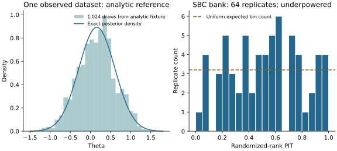

# SBC execution

`op_infer.sbc.run_sbc` schedules a fixed bank of calibration replicates. Install
`op_infer[study]`; fitting remains the caller's reporting estimator. The runner
uses `trade_study.run_grid` for scheduling and the existing `op_infer.calibrate`
rank-file schema for aggregation. It introduces no sampler or executor.
For leave-one-unit-out calibration, use the [masked-unit runner](masked-sbc.md),
which retains complete planned IDs, stratum counts and baseline comparisons.

Supply a prior sampler, simulator and estimator accepting `RandomKey` addresses,
a mapping of `SBCEstimand` records, real observations and their optional mask,
complete `Provenance`, a root seed, and explicit prespecified replicate IDs.
Each estimand transforms either parameter scalars or posterior variable arrays
into a scalar truth or one value per draw. Its prior SD must use the same scale;
declare `atoms=True` for point masses or discrete quantities. The estimator
returns `SBCFit(draws, diagnostics)` with scalar variables on one draw dimension.

Parameter, simulation, reporting-estimator and per-estimand rank streams are
separate. IDs do not depend on grid position, shard size or worker order. Split a
planned bank into disjoint ID sets and use the same seed, provenance and directory
for every shard. `n_jobs` delegates local parallel execution to trade-study; the study extra
installs its native parallel dependency.

The simulator must implement the same prior, observation support and acceptance
rule used for training/fitting. The runner applies no extra plausibility filter.
It checks simulated data against the real observations before fitting or ranking.
Simulation errors, non-finite draws, estimator failures and inadequate MCMC fits
become failed records and stay in the denominator. Catchable timeouts can be
reported as failures; a worker killed before writing a record remains an
unfinished task, not a successful replicate.

MCMC fits require `kind="mcmc"`, an explicit `adequate=True` verdict and finite
`effective_sample_size >= 2`. The runner retains supplied diagnostics and uses
evenly spaced draws up to floor(ESS). This policy does not compute adequacy or
prove those draws independent; the estimator adapter owns that qualification.
Independent NPE draws use `kind="independent"` and do not fabricate MCMC statistics.

An atomic `sbc-manifest.meta` contains the complete provenance and settings; each
`rep_*.json` references its identity and stable replicate ID in `_meta`. The
caller must identify callback/model/estimator revisions in provenance. Existing
files are reused only under the same contract, including seed, observation bytes,
mask, estimand names, atom rules and prior SDs. Failed records remain failed on
resume. Use a new directory for a scientific revision or a deliberate rerun.
Concurrent duplicate IDs fail through explicit lock files; remove a stale lock
only after verifying that its worker has stopped.

After all planned shards finish, call `load_replicates`, `aggregate` and `gate`.
Write the aggregate ledger outside the replicate directory, whose `*.json` files
are all interpreted as replicate records. `SBCExecution` reports requested,
written, resumed and failed counts; it is not a calibration verdict. Preselect
replicate counts using the trade-study proportion/precision helpers and retain
the aggregation power floor and multiplicity rules. A small unflagged bank does
not establish calibration. Use `coverage_summary` for marginal Wilson coverage summaries,
[coverage planning](coverage-planning.md) for a fixed coverage family and optional
reference TARP curves, and [saved gate records](gates.md) for prespecified scalar
criteria and amendments.

## Illustrated analytic fixture

The runnable `examples/normal_sbc.py` uses a normal prior and four independent
unit-variance observations, with an exact normal posterior. Its illustrative
bank contains 64 replicates and is deliberately underpowered.



--8<-- "docs/assets/normal-sbc/summary.txt"

For the observed data `[0.2, -0.1, 0.3, 0.4]`, the posterior mean is
`sum(y) / 5 = 0.16` and its variance is `1 / 5`. The left panel compares draws
from the analytic fixture with that independent mathematical reference. The
right panel displays the actual bank's rank PITs; the dashed line is the
uniform expected bin count. A small bank's apparent histogram shape and
`underpowered pass` label cannot establish calibration or adequate gate power.
The exact posterior is a fixture, rather than an implemented sampler.

[Download the vector PDF](assets/normal-sbc/figure.pdf). From a checkout:

```bash
uv run --extra study --with matplotlib==3.11.2 python examples/illustrate_normal_sbc.py
just figures-check
```

Generation uses a fresh temporary bank, checks guarded resume, and retains the
full [plotted inputs](assets/normal-sbc/data.json). The check reruns the same fixture and
verifies the table, plotted data and source/export fingerprints without
Matplotlib. It requires the study extra and runs in the required study CI job.
